# SDK natif ou framework ? — Cas pratiques

> Séance du 18.11.2025 — **document apprenant·e**. Aucun cours, aucun code : on **décide** et on **défend**.

## La règle du jeu

On ne vous demande **pas** d'utiliser un framework. On vous demande de décider **s'il en faut un**, et **lequel**.

Un système IA peut se construire **entièrement avec le SDK natif du provider** (OpenAI, Anthropic) : vous appelez l'API directement, vous écrivez vous-même la boucle, le dispatch des outils, la mémoire, le parsing. Un framework (LangChain, LangGraph, CrewAI) ou un orchestrateur (n8n) ne se justifie **que s'il résout un problème que vous auriez de toute façon**.

> ⚖️ **Deux erreurs symétriques à éviter**
> - « On fait de l'IA → donc LangChain. » → framework pour le framework = **dette** et magie cachée.
> - « Jamais de framework, tout en SDK natif, c'est plus propre. » → vous **réinventez** mal une machine à états, un orchestrateur, 50 connecteurs.
>
> Le bon réflexe n'est ni l'un ni l'autre : **de quelles capacités mon système a-t-il besoin ?**

## Les options sur la table

| Option | Ce que c'est |
| --- | --- |
| **SDK natif** (openai / anthropic) | Appels API directs. Contrôle total, peu de dépendances, vous codez la plomberie. |
| **LangChain** | Briques prêtes : prompts, tools, retrievers, memory, parsers, intégrations. |
| **LangChain + LangGraph** | Les briques **+** un moteur d'orchestration stateful : état, branches, boucles, validation humaine, **reprise après crash**. |
| **CrewAI** | Équipe d'agents aux **rôles distincts** qui collaborent vers un but. |
| **n8n** | Orchestrateur **low-code** : 400+ connecteurs, déclencheurs, planification, nœuds AI/MCP. |
| **Combinaison** | Ex. n8n déclenche → agent code pour la logique fine ; ou SDK natif dans un nœud LangGraph. |

> 📺 **Démystification — « agent de démo » vs « agent de prod »**
> Sur TikTok/YouTube, *« je fais des agents avec n8n »* est partout. Avant de copier le réflexe, sachez lire ce qu'on vous montre.
>
> - **Le mot « agent » veut dire 2 choses.** Sens **strict** (ingénieur) : il **planifie, décide, agit** — le LLM choisit ses outils, boucle, est autonome (flux *dynamique*). Sens **réseaux** : *« tout ce qui fait une tâche avec un LLM dedans »* — barre très basse. Beaucoup de « agents » montrés = un **workflow + une étape LLM**, habillé du mot « agent ». Pas faux, pas nul — mais **ce n'est pas de l'agentivité autonome**.
> - **Pourquoi n8n domine ce contenu ≠ supériorité technique.** C'est **visuel, no-code, démontrable en 60 s**, riche en intégrations qui filment bien, et vendeur (« ton agent IA sans code »). Les réseaux montrent ce qui se **démo**, pas ce qui se **maintient**.
> - **n8n fait pourtant de vrais agents** (nœud *AI Agent*, outils, mémoire, MCP). Le point n'est pas « n8n ne sait pas », c'est : **un agent de démo et un agent de prod ne jouent pas dans la même cour.**
>
> | « Agent n8n » est légitime pour… | Le **code** (SDK / LangGraph) gagne pour… |
> | --- | --- |
> | automations **riches en intégrations**, démos, prototypes | **logique fine**, prompts complexes, **état/branches/reprise**, **tests/CI**, embarqué dans une app |
>
> 🎯 **La règle ne change pas :** on ne choisit pas (ni ne rejette) un outil parce qu'il est **populaire** — on part du **besoin**. Intégrations + vitesse → n8n ; logique fine + état + tests → code. Souvent on **combine**.

## Votre boîte à outils de décision

Pour **chaque** cas, justifiez votre choix avec ces axes. Nommez explicitement ceux qui tranchent.

1. **Complexité du flux** — appel unique / chaîne simple ? ou stateful, branches, boucles, **reprise après crash** ?
2. **Agentivité** — assistant qui répond ? ou agent qui planifie, décide, **agit** (outils, écrit dans des systèmes) ?
3. **Portabilité provider** — dois-je pouvoir changer de modèle/provider sans tout réécrire ?
4. **Intégrations & déclencheurs** — combien de systèmes à brancher ? des triggers / de la planification ?
5. **Collaboration de rôles** — plusieurs agents **spécialisés** dont l'un alimente l'autre ?
6. **Contrôle, transparence, audit** — dois-je expliquer/tracer chaque prompt et décision (secteur régulé) ?
7. **Équipe & durée de vie** — qui maintient ? quel niveau ? prototype jetable ou système prod 5 ans ?
8. **Time-to-market vs dette** — livrer vite ? au prix de quelle complexité cachée plus tard ?

> 🎯 **C'est un échange — rien à rendre.** Pour chaque cas, on en discute ensemble ; chacun·e prend position à l'oral en répondant à trois questions :
> 1. **Quel choix ?** …
> 2. **Quel(s) axe(s) tranche(nt) ?** …
> 3. **Qu'est-ce que je refuse, et pourquoi ?** (quelle option serait du sur- ou sous-outillage ici)
>
> Le désaccord est bienvenu : plusieurs cas ont **deux bonnes réponses**. Ce qui compte, c'est la **raison**, pas le mot.

### Repère visuel — les 6 formes de flux (appui de l'axe 1)
Avant de juger « faut-il un orchestrateur ? », nommez la **forme** du flux. Seule la forme **linéaire** ne justifie jamais LangGraph à elle seule ; la **boucle** et l'**interruption/reprise** sont ses vraies raisons d'être ; le flux **dynamique** (décidé par le LLM) relève de l'agent.

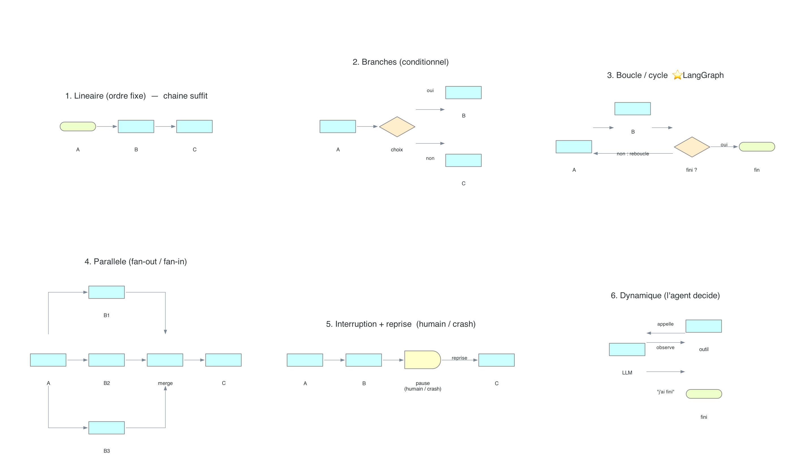

| Forme | Connu d'avance ? | Besoin d'un orchestrateur (LangGraph) ? |
| --- | --- | --- |
| 1. Linéaire | oui, fixe | ❌ chaîne / script suffit |
| 2. Branches | oui, mais choix | 🟡 utile dès que ça se ramifie |
| 3. Boucle / cycle | oui, mais répété | ✅ **oui** (les chaînes ne bouclent pas) |
| 4. Parallèle | oui | 🟡 gérable, l'orchestrateur aide |
| 5. Interruption / reprise | oui | ✅ **oui** (persistance d'état) |
| 6. Dynamique (agent) | **non**, décidé au runtime | ✅ oui (ou framework d'agent) |

---

## Les cas

> Chaque cas est un **schéma** : lisez d'abord la **forme** du système (flux simple ? branches + reprise ? beaucoup d'intégrations ?). La forme est votre meilleur indice.

### Cas A — 50 000 avis clients à classer
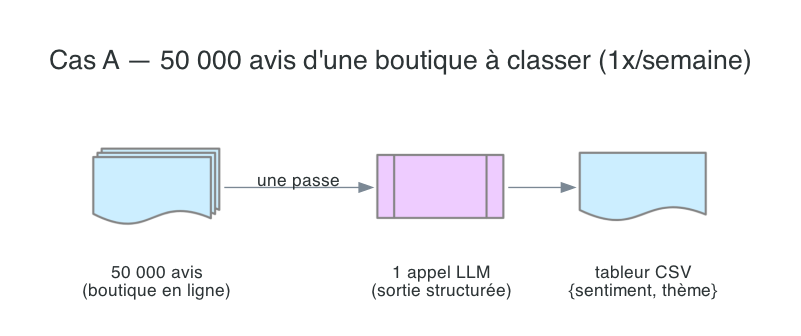
Une **boutique en ligne** veut classer **50 000 avis clients** (positif / négatif + thème) en **une passe**, export **tableur (CSV)**, script lancé **1×/semaine**. Pas d'interaction, pas de mémoire, pas d'outils.

### Cas A′ — même batch, mais on compare les providers
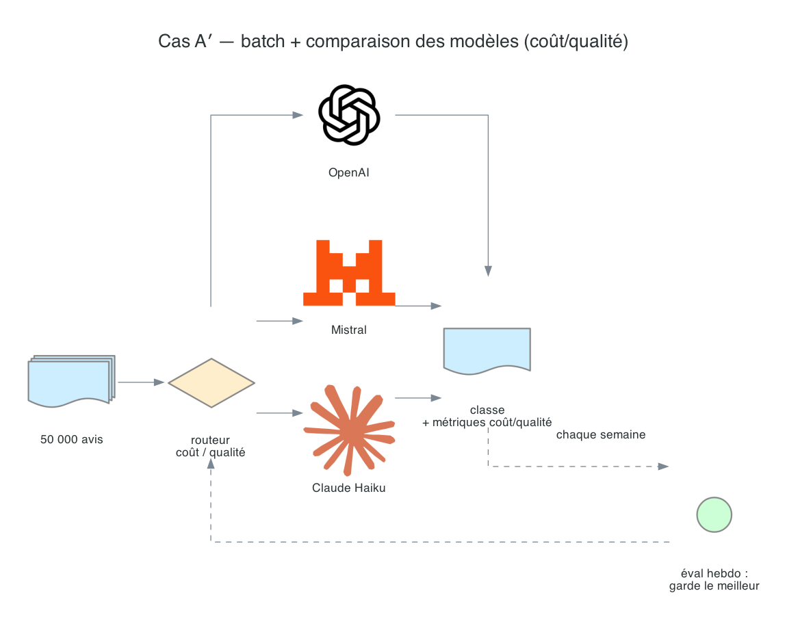
**Un seul besoin ajouté** au Cas A : chaque semaine, on doit **comparer les modèles** (OpenAI / Mistral / Claude…) sur le **coût** et la **qualité** de classement, et garder le meilleur. Le reste est identique (batch, une passe, CSV).
> ❓ La réponse du Cas A tient-elle encore ? Qu'est-ce qui a changé — le flux, ou **le besoin** ? Et ce switch de provider, **impose-t-il** un framework ?

### Cas B — Démo chatbot d'association dans 4 jours
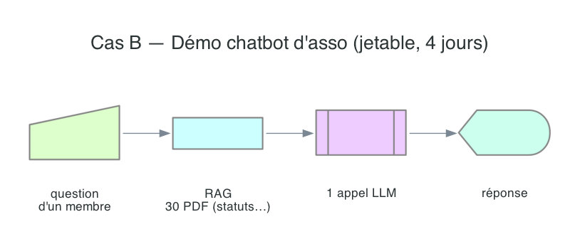
Le bureau d'une **association** veut une **démo** de chatbot qui répond aux questions des membres à partir de **30 PDF** (statuts, règlement, comptes-rendus). **1 appel LLM + petit RAG**, démo dans 4 jours, **jetable** après. Un seul dev bénévole.

### Cas C — Traitement de dossiers de location
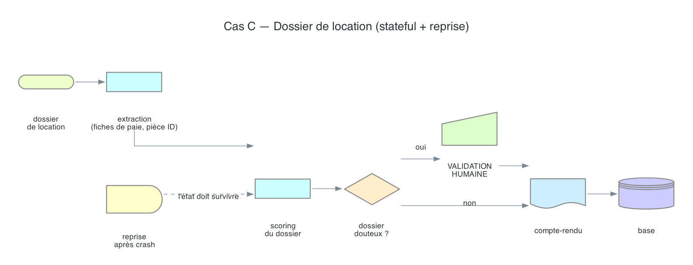
Une **agence immobilière** traite des **dossiers de location** : extraction des pièces (fiches de paie, pièce d'identité) → **scoring** du dossier → **si douteux : validation humaine** → sinon acceptation auto → compte-rendu → base. Le traitement **doit reprendre après un crash serveur**. Plusieurs branches.

### Cas D — Même assistant vendu à plusieurs clients
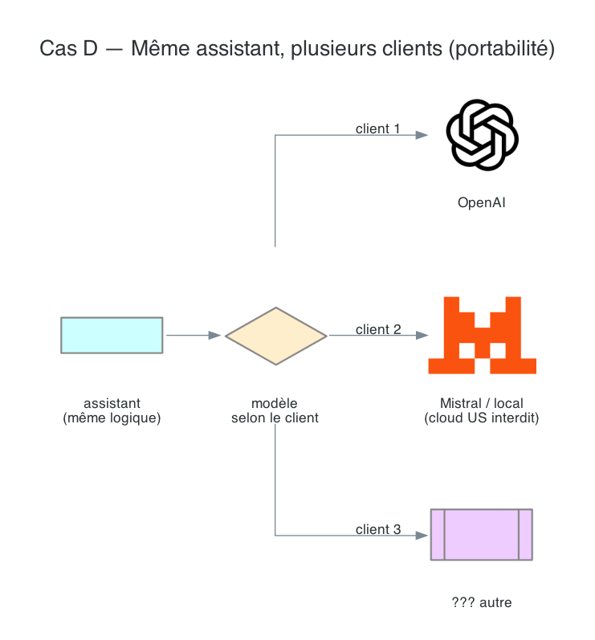
Vous vendez le **même assistant** à plusieurs clients. L'un **impose OpenAI**, un autre **interdit le cloud US** (→ modèle européen / local). Vous devez **changer de modèle selon le client** sans réécrire la logique.

### Cas E — Comparatif d'achat
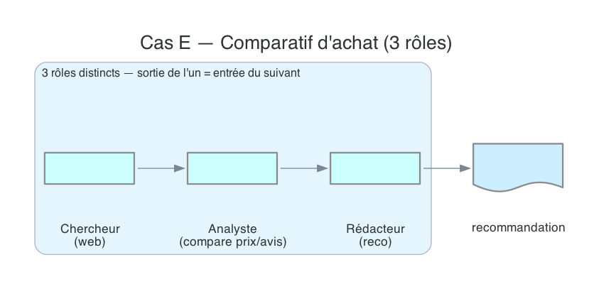
Produire un **comparatif d'achat** (ex. *quel vélo électrique acheter ?*) : un agent **Chercheur** (web) collecte les options → un agent **Analyste** compare prix/avis → un agent **Rédacteur** écrit la recommandation. Rôles distincts, la sortie de l'un alimente le suivant, but commun : une reco.
> ⚠️ Piège : « passer la sortie de l'un à l'autre » **n'est pas** de l'orchestration stateful. Un pipeline linéaire n'a besoin ni de LangGraph ni d'A2A. Qu'est-ce qui, **en plus**, les justifierait ? → voir E′.

### Cas E′ — on ajoute un besoin : lequel change la réponse ?
Deux variantes, **un besoin ajouté chacune**. Même trio Chercheur → Analyste → Rédacteur.

**(a) Contrôle de flux réel** — *« si le comparatif est jugé insuffisant, reboucler sur une nouvelle recherche »* + *« reprendre après un crash »*.
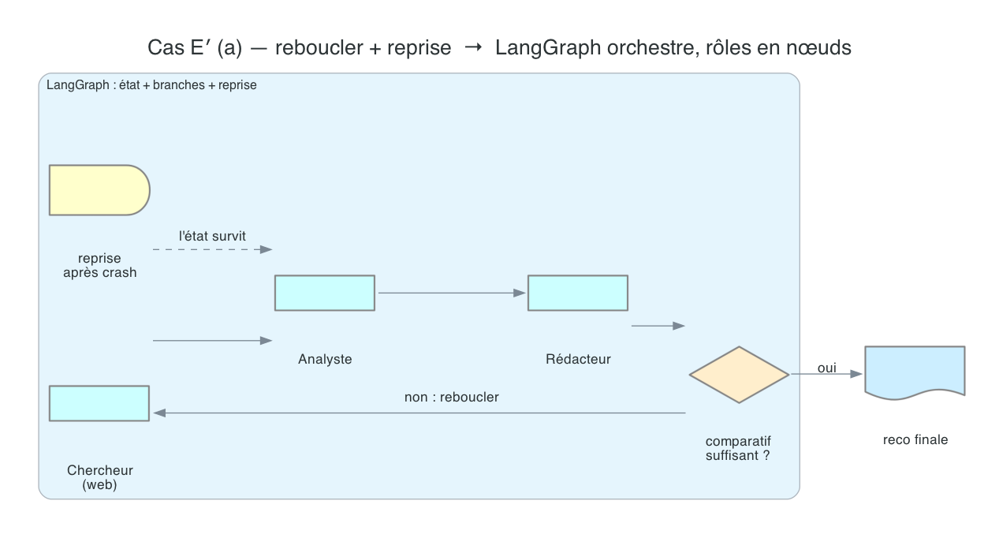

**(b) Frontière de propriété** — *« l'Analyste est en fait l'agent d'une **autre équipe / d'un éditeur tiers** »*.
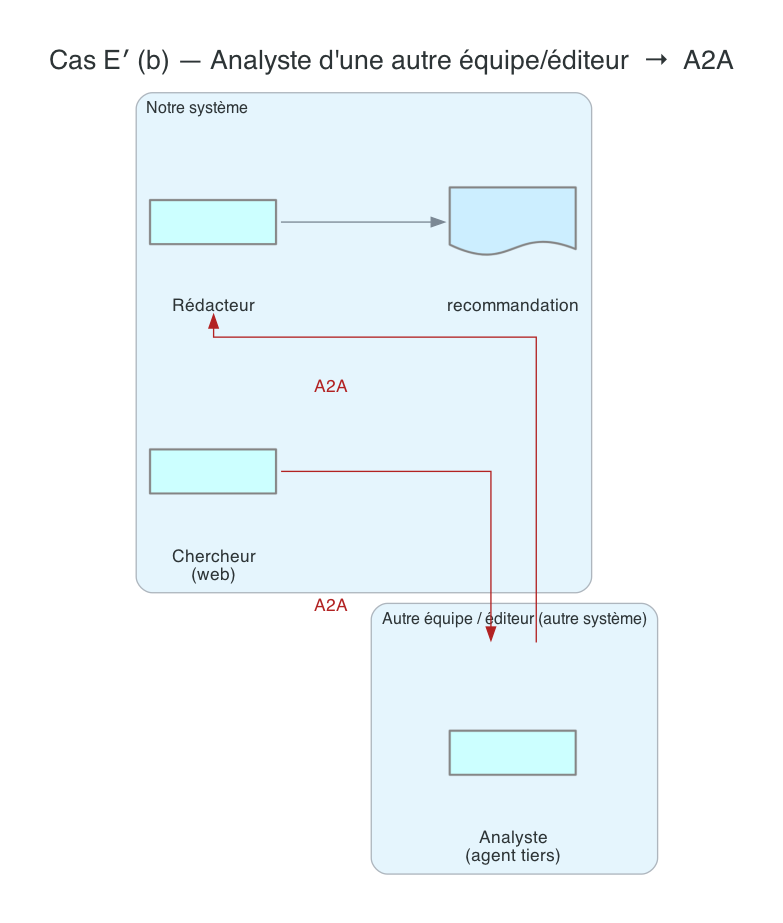

> ❓ Pour **chaque** variante : est-ce le **flux** ou la **frontière** qui a changé ? Lequel justifie LangGraph ? Lequel justifie A2A ? Et le Cas E d'origine — avait-il besoin de l'un des deux ?

### Cas F — Automation : email prospect → tâche → notif
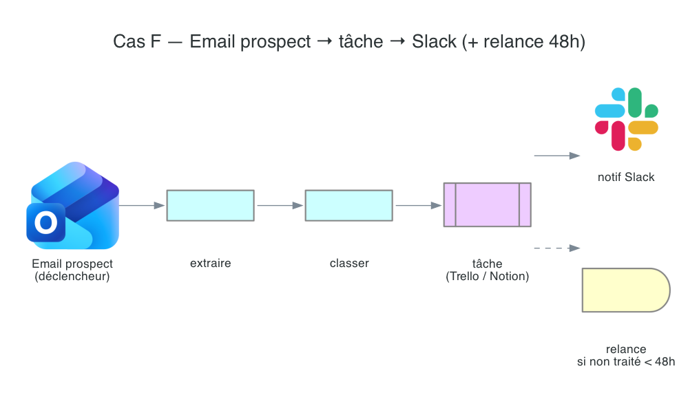
Un **freelance** : chaque email d'un **nouveau prospect** (déclencheur) → extraire → classer → créer une **tâche (Trello / Notion)** → **notifier sur Slack** → **relancer** si non traité sous 48h. Beaucoup d'intégrations, un trigger, de la planification.

### Cas G — Agent en secteur contrôlé, durée de vie 5 ans
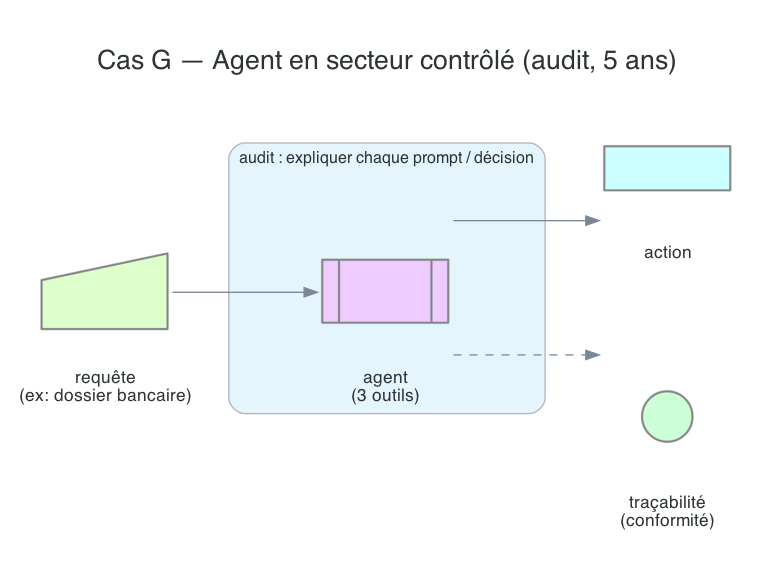
Secteur **contrôlé** (banque / santé / juridique). Agent **tool-calling simple** (3 outils) en prod, **durée de vie 5 ans**, **audit exigé** : il faut **expliquer et tracer chaque prompt/décision** (ex. un dossier bancaire ou médical). Équipe de 2 devs seniors.

## Les exigences qui décident vraiment — coût, confidentialité, fiabilité
> Ici, ce qui tranche n'est souvent **pas** la feature IA, mais une **exigence transversale** (observabilité, fiabilité, confidentialité). Même question, **dans le menu** : *quel outil porte cette exigence — le **SDK natif**, un **framework** (LangChain/n8n), ou une **combinaison** ?*

### Cas I — Suivre le coût et tracer plusieurs outils IA
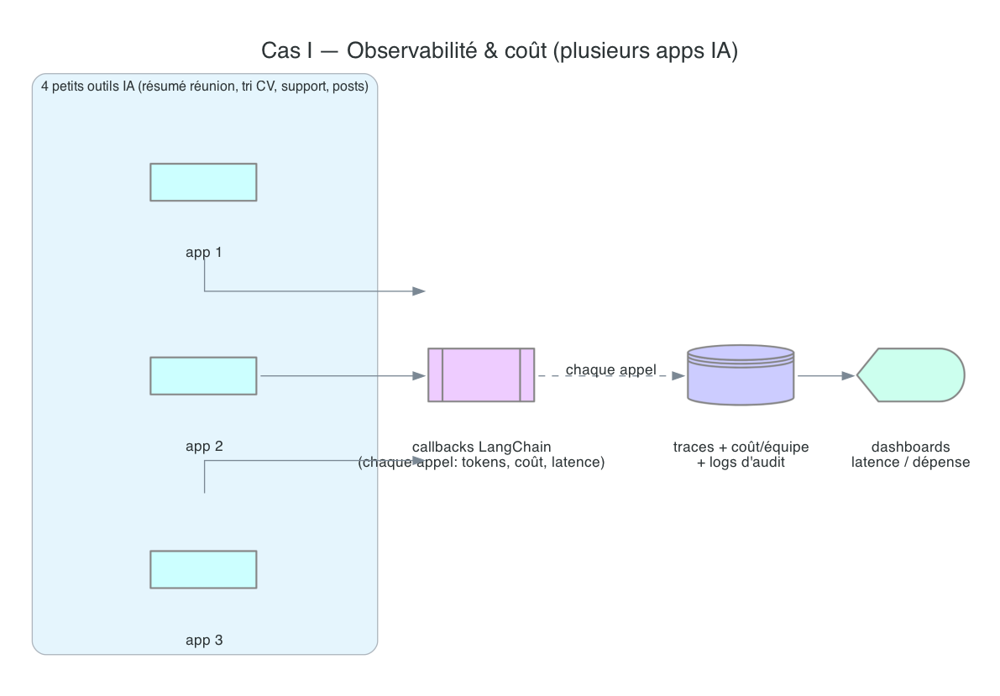
Votre équipe a lancé **4 petits outils IA** (résumé de réunions, tri de CV, chatbot support, génération de posts). La direction veut : **tracer chaque appel** LLM, **coût par équipe**, dashboards latence/dépense, **logs d'audit**. Plusieurs apps concernées.

### Cas J — Traiter des dossiers confidentiels en local
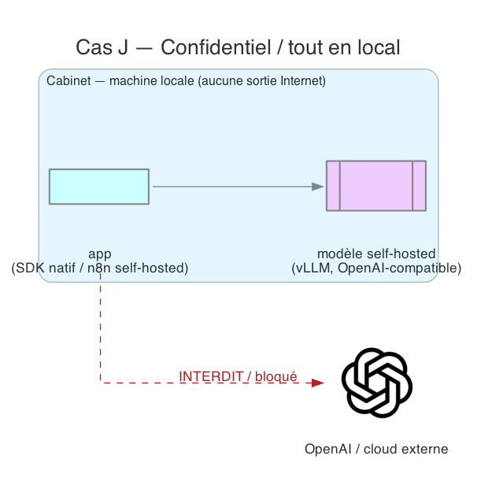
Un **cabinet** (médical ou avocat) traite des **dossiers confidentiels**. **Aucune API externe autorisée**, tout tourne sur une **machine locale** (modèle **self-hosted** vLLM, endpoint OpenAI-compatible). Rien ne doit « téléphoner dehors ».

### Cas K — Ne jamais tomber : fallback multi-modèle
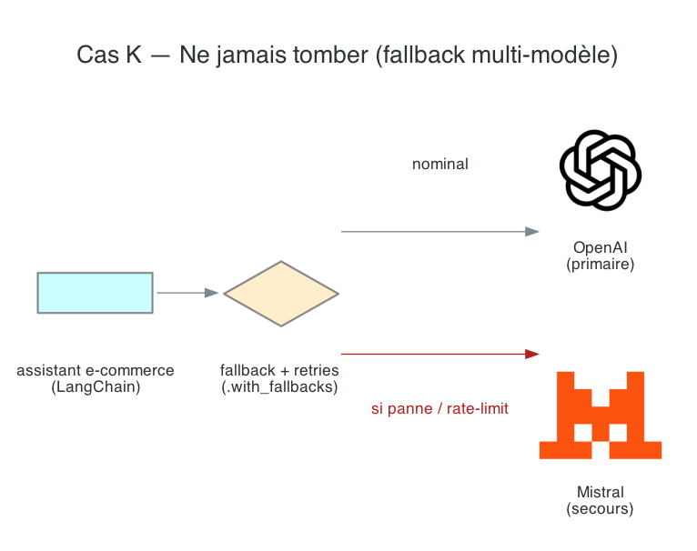
L'assistant d'un **site e-commerce** tourne **en continu** (engagement de dispo élevé). Si le modèle primaire **tombe ou sature** → **bascule automatique** sur un modèle de **secours**, avec **retries**. Le service **ne doit jamais s'arrêter**.

### Cas H — Le débat (à trancher en groupe)
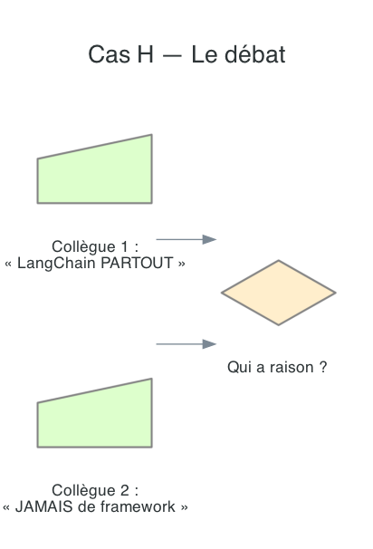
Collègue n°1 : *« LangChain partout, c'est le standard, on est couverts pour tout. »*
Collègue n°2 : *« Jamais de framework. Tout en SDK natif — le reste, c'est de la dette et de la magie cachée. »*
**Qui a raison ? Formulez la réponse d'architecte.**

---

> 📌 Question transversale pour clore l'échange : dans combien de cas le **SDK natif seul** suffisait réellement ? Qu'est-ce qui, concrètement, **fait gagner** sa place à un framework ?

---

## En résumé — pourquoi (et quand) utiliser chaque outil ?

> Un outil se choisit pour ce qu'il **apporte en plus** (ses modules / briques), jamais par défaut. Voici ce que chacun **fournit déjà** pour que tu ne l'écrives pas toi-même.

### Pourquoi utiliser **LangChain** ?
Pour ses **briques IA prêtes à l'emploi** — tu assembles au lieu de recoder la plomberie :
- **Chat models unifiés** : une même interface pour OpenAI / Mistral / Claude → changer de modèle en ~1 ligne.
- **Prompts / templates** réutilisables.
- **Output parsers** : forcer une **sortie structurée** (JSON, schéma) et la valider.
- **Tools / function calling** : brancher des outils à un LLM.
- **Document loaders + text splitters + retrievers + embeddings** : tout le **RAG** prêt (PDF, découpe, recherche).
- **Memory** : historique de conversation.
- **Callbacks** : capter chaque appel (tokens, coût, latence) pour tes logs.
> **Quand :** tu veux **gagner du temps** sur des briques IA standard (RAG, parsing, tools). **Pas** pour une simple boucle.
> 👉 **Ex. :** la **démo chatbot de l'asso** (Cas B) — loader PDF + découpe + retriever + chaîne RAG **déjà prêts** → livrée en 4 jours. **Pas** pour classer 50 000 avis (Cas A), où une boucle + un appel suffisent.

### Pourquoi utiliser **LangGraph** ?
Pour son **moteur d'orchestration stateful** — ce que les simples chaînes ne savent **pas** faire :
- **Machine à états / graphe** : étapes nommées, enchaînement explicite.
- **Branches conditionnelles** (si risque élevé → humain, sinon auto).
- **Boucles / cycles** (reboucler jusqu'à un seuil).
- **Persistance d'état (checkpointing)** → **reprise après crash**.
- **Human-in-the-loop** : interrompre, attendre une validation, reprendre.
> **Quand :** le flux est **stateful** (branches, boucles, reprise, validation humaine). **Pas** pour un pipeline linéaire.
> 👉 **Ex. :** le **dossier de location** (Cas C) — *si le dossier est douteux → validation humaine, sinon acceptation auto*, et le traitement **reprend après un plantage serveur**.
> ⚠️ **À ne pas confondre :** Chercheur → Analyste → Rédacteur (Cas E) est **linéaire, sans état** → LangGraph n'apporte rien. Le fait qu'il y ait **3 rôles** relève de **CrewAI** (collaboration), **pas** de LangGraph (flux). Autrement dit : *3 agents linéaires qui collaborent → CrewAI, pas LangGraph.* LangGraph ne se mérite que si un **vrai besoin de flux** s'ajoute (reboucler, reprise) → voir Cas E′.

### Pourquoi utiliser **CrewAI** ?
Pour modéliser une **équipe d'agents à rôles distincts** qui collaborent :
- **Agents** : chacun a un **rôle**, un objectif, ses outils.
- **Tasks** : tâches assignées aux rôles.
- **Handoff natif** : la sortie d'un rôle devient l'entrée du suivant (task context).
- **Process** séquentiel ou hiérarchique.
> **Quand :** tu raisonnes vraiment en **équipe de rôles** (Chercheur → Analyste → Rédacteur). **Pas** juste « il y a plusieurs agents ».
> 👉 **Ex. :** le **comparatif d'achat** (Cas E) — 3 rôles qui se passent la main : CrewAI gère le **handoff** nativement. ⚠️ Mais « 3 agents » ne décide **rien** : un simple **script séquentiel** (SDK natif) marche aussi ; CrewAI **gagne** seulement si la valeur est la **collaboration de rôles**, pas le simple enchaînement.

### Pourquoi utiliser **n8n** ?
Pour la **plomberie d'intégration en low-code** — 80 % du travail quand c'est de l'automation :
- **400+ connecteurs** prêts (email, Slack, Trello/Notion, bases, API…).
- **Déclencheurs (triggers)** et **planification** (cron, *wait*, relance différée).
- **Nodes IA natifs** : **Text Classifier**, **AI Agent** → classer/agir **sans code**.
- **Webhooks / MCP** : appeler un agent code **seulement** si besoin.
> **Quand :** beaucoup d'**intégrations + triggers + planif**, à livrer vite. **Pas** pour de la logique fine testée/versionnée.
> 👉 **Ex. :** l'**automation du freelance** (Cas F) — email prospect (trigger) → tâche Trello/Notion → notif Slack → **relance à 48h** : tout en connecteurs prêts, la classification via le **node IA natif**, **sans code**.

### Pourquoi rester en **SDK natif** (openai / anthropic) ?
Pour le **contrôle total** avec un minimum de dépendances — tu écris toi-même la plomberie :
- **Appels API directs** : tool calling, **sortie structurée**, streaming, retries sont déjà là.
- **Zéro indirection** → **auditabilité** maximale (rien de caché).
- **Surface minimale** → moins de breaking changes sur la durée.
> **Quand :** flux **simple**, exigence de **transparence/audit**, ou équipe senior qui veut tout maîtriser.
> 👉 **Ex. :** les **50 000 avis** (Cas A : une boucle + un appel) et l'**agent en secteur contrôlé** (Cas G : 3 outils, tout doit rester **explicable et traçable sur 5 ans**, zéro magie cachée).

> 🎯 **La règle qui relie tout :** on **combine** souvent (SDK natif dans un nœud LangGraph ; n8n + agent code). Le bon réflexe reste : *« qu'est-ce que cet outil SUPPRIME que j'aurais dû écrire ? »* Si la réponse est « rien » → sur-outillage.
